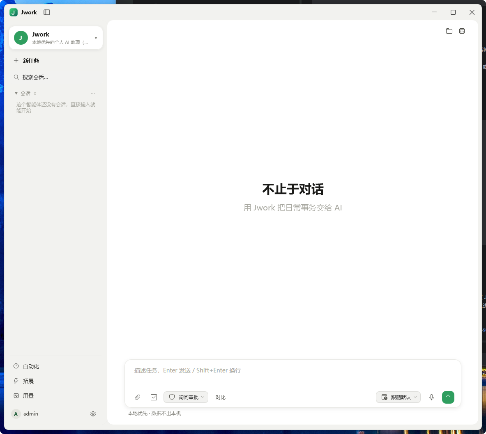
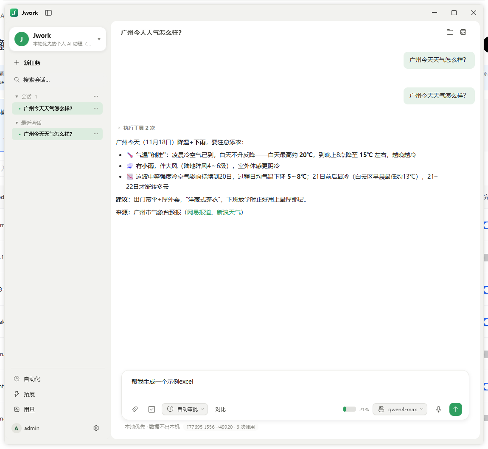
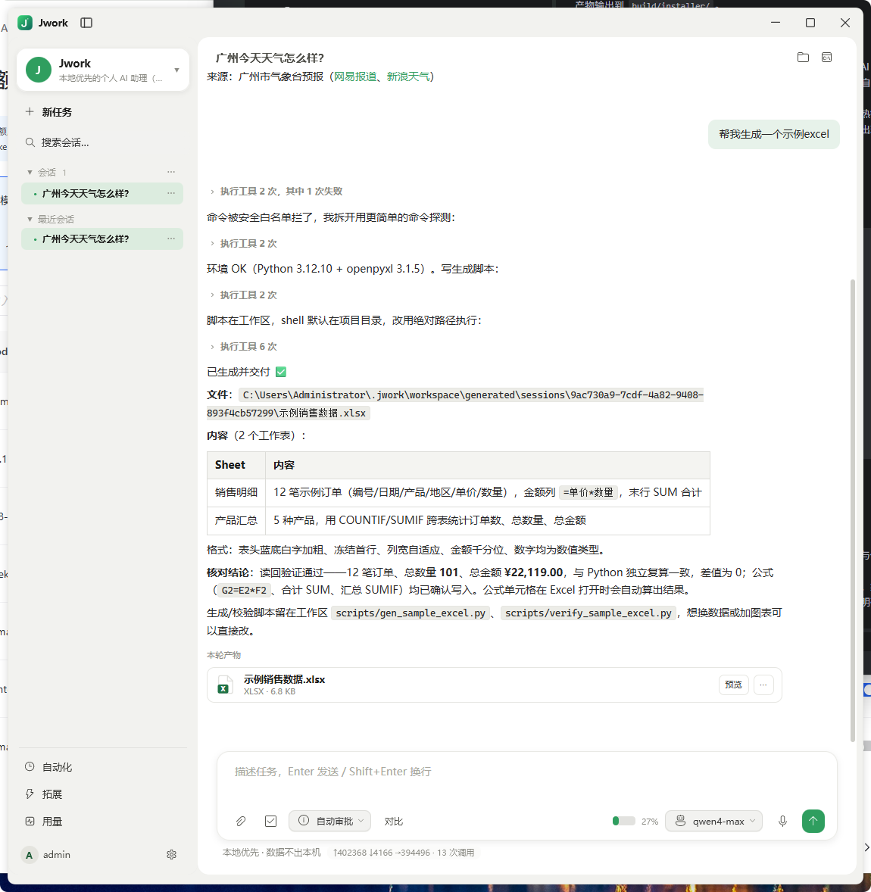
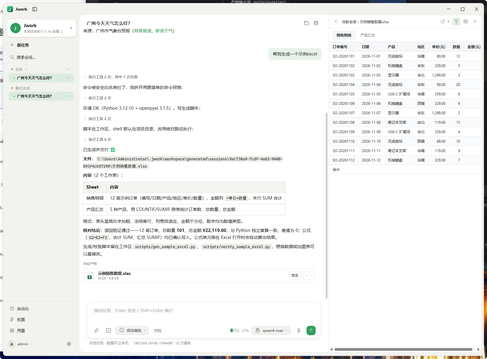
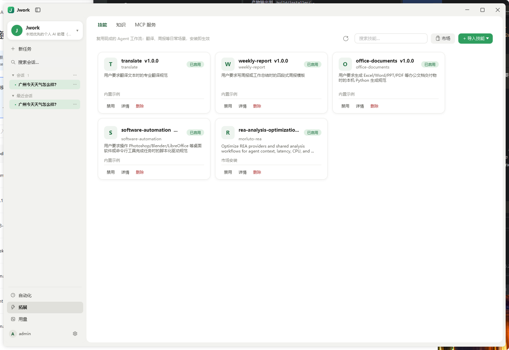
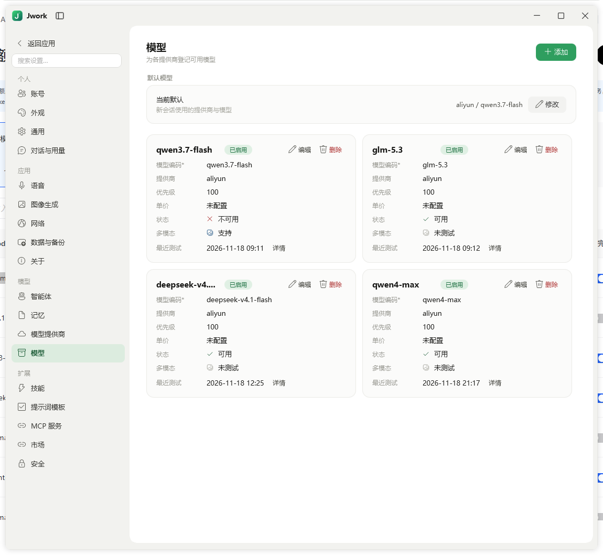

<p align="center">
  
</p>

# Jwork

[English](README.md) | 简体中文

**Windows 上的本地优先 AI 工作台——杂活它干，决策你留。**

Jwork是一个真正在你机器上干活的桌面 AI 助理：读写真实文件、经你批准后执行命令、基于你自己的文档回答问题、联网搜索、跑定时任务，并跨会话记住你的上下文。一切数据都存放在你磁盘上的 `~/.jwork/`——无需账号、不依赖云服务。接入任意 OpenAI 兼容提供商，或本地模型服务（Ollama / LM Studio），就可以开始委派了。

<p align="center">
  
</p>

## 它能为你做什么

### 1. 接管文件与代码杂活

- *「把这堆文件整理一下」「找出所有用到 X 的地方」「写个脚本跑起来」*——智能体在真实的按智能体隔离工作区里干活：带行号读取、正则 grep、按修改时间排序的 glob、防误覆盖写入；Shell 命令置于**守卫链**之后（危险命令策略、可执行文件白名单、路径白名单），且**每次调用都需你确认**；风险较高的任务可选 Docker 沙箱。
- 成果以**产物**形式落地：工作区面板（产物优先的文件树）与应用内预览窗直接展示生成了什么；想自己动手时，**集成终端**就在旁边。
- **解决的问题：** 不再在聊天窗口、资源管理器和编辑器之间来回复制粘贴——活儿在文件所在的地方干完，风险操作由你把关。

### 2. 把文档变成答案

- **PDF / Word / Excel** 附件直接拖进聊天——正文自动抽取并作答，无需手动复制内容。
- 按智能体构建**知识库**，向量检索（RAG，嵌入提供商可配置）：跨手册、笔记与规范直接提问，不必重读一遍。
- **长期记忆**（`MEMORY.md`、沉淀档位、按作用域管理）在会话之间保留你的偏好与项目上下文——不用每周一都重新交代一遍。
- **解决的问题：** 知识不再只存在于你的脑子里，或躺在没人翻的文件夹里。

### 3. 不打断心流地回答

- **全局热键快速提问**、**划词助手**（在任意应用中选中文字→就地提问）、**截图捕获**直达输入框、**语音输入**（16 kHz PCM），托盘常驻、开机自启。
- 完成的回答可通过可配置的 OpenAI 兼容 TTS **朗读**——眼睛忙的时候用耳朵。
- **解决的问题：** 问题出现的那一刻就能问出去，不用切窗口、不用敲一长串提示词。

### 4. 自动化重复工作

- **定时任务**（cron 或一次性，持久化并在启动时自动恢复）：每日汇总、周期巡检、提醒——智能体自己跑、跑完向你汇报。
- **技能包**与 **MCP 服务器**均带**市场**（九宫格浏览、游标分页、GitHub 直连）：不写代码也能扩展智能体的能力。
- **子智能体委派、计划模式与内置任务清单**应对多步骤任务；智能体还能在回合中**向你提出点选式问题**，而不是猜错方向。
- **解决的问题：** 重复性工作自己跑；一次性的复杂工作有章法，不再临场发挥。

### 5. 让写作与交付更快

- 流式 **Markdown** 渲染，代码语法高亮与 **Mermaid 图表**；停止 / 重新生成 / 编辑重发；**从任意消息派生新会话**；多智能体对话，每个智能体独立人格、模型与能力白名单。
- **多模型对比模式**：同一提示词在多个模型上并排运行——挑最好的答案，也挑最合适的价格。
- 会话导出 **Markdown / JSON / HTML / 长图，含密钥脱敏**——放心分享成果。
- **解决的问题：** 起草 → 评审 → 交付在一处完成，分享时不会泄露你的 API 密钥。

### 6. 长会话可靠且花得明白

- **上下文窗口浮层**实时展示占用明细，一键压缩（远端压缩失败自动降级为本地归档压缩）——长对话不会死在上限处。
- **备用模型 failover**、重试策略配人话化失败文案（永久额度类错误直接呈现，不盲目重试）。
- **Token 用量与成本估算**，月度预算提醒；逐模型限流与价格表；连通性探测；自动发现本地 Ollama `:11434` / LM Studio `:1234`。
- **应用内更新检查**：每日静默检查、带进度下载、静默安装，关键版本强制更新弹窗。
- **解决的问题：** 没有静默失败、没有意外账单、没有「上下文已满」的死胡同。

### 7. 数据始终是你的

- 一切本地：SQLite（WAL）+ 工作区 + 日志 + 滚动备份，全部在 `~/.jwork/` 下；凭据采用 **Windows DPAPI + AES-GCM** 加密。
- 本地登录门槛，免登录有效期可配置（1–90 天）；可选 **WebDAV 同步（载荷加密）**；细粒度的工具 / 文件 / 联网守卫配置与授权管理。
- 除非你主动配置远程提供商、同步或代理，聊天数据不会离开本机。
- **解决的问题：** 公司文档与个人笔记留在你自己的磁盘上，而不是别人的云里。

## 体验与掌控

- 分组化设置——**个人 / 应用 / 模型 / 扩展**，共 18 页——带菜单内搜索；品牌化关于页展示版本、源码仓库与许可证链接。
- 界面语言：English / 简体中文 / 繁體中文 · 亮暗主题 · 三档字号。
- 会话搜索命令面板（标题 + 全文）、会话分组、按工作区组织的会话管理。

## 界面截图

| 联网搜索并附来源 | 守卫链与产物交付 |
| --- | --- |
|  |  |
| **应用内产物预览** | **技能市场** |
|  |  |

## 架构

| 模块 | 职责 |
| --- | --- |
| `jwork-agent-domain` | SQLite 持久化（schema、DAO、实体）、备份恢复、安全原语 |
| `jwork-agent-core` | 智能体运行时（AgentScope Harness 网关）、聊天服务、记忆/知识/计划、能力解析 |
| `jwork-agent-tools` | 工具守卫、HITL 确认、Docker 沙箱、技能、联网搜索、图像生成 |
| `jwork-agent-scheduler` | 基于 Quartz 的调度服务与面向智能体的定时任务工具 |
| `jwork-agent-ui` | JavaFX 应用：JCEF 渲染的聊天区、工作区与终端、设置、桌面集成、云同步、语音 |

模块依赖方向：`ui → scheduler / tools / core → domain`。

## 技术栈

- **Java 21** + **JavaFX 21**（AtlantaFX）+ **JCEF**（Chromium OSR 渲染）+ **JediTermFX**（集成终端）
- **AgentScope Java 2.0.5**（HarnessAgent）作为智能体运行时
- 手写**组合根**（`AppContext`）显式装配——不引入 DI 框架
- **SQLite**（xerial JDBC，WAL）——无 ORM，纯 DAO
- **Quartz** 调度 · **jpackage / WiX** Windows 打包

## 快速开始

### 环境要求

- Windows 10/11（主要目标平台；全局热键、开机自启、DPAPI 等桌面集成为 Windows 专属）
- JDK 21（如 Liberica、Temurin）· Maven 3.9+

### 从源码运行

```powershell
# 构建全部模块（快速启动可跳过测试）
mvn -q -DskipTests install

# 启动应用
mvn -pl jwork-agent-ui javafx:run
```

也可以用 IntelliJ IDEA 打开项目，直接运行 `com.gettyio.jwork.agent.ui.JworkAgentApplication`（JCEF/OSR 所需模块导出参数已在 `.run/` 中预置）。

### 构建 Windows 安装包

```powershell
# app-image（无额外依赖）或 msi（需 WiX Toolset v3 在 PATH 中）
powershell -ExecutionPolicy Bypass -File .\scripts\package-windows.ps1 -Type msi
```

产物输出到 `build/installer/`。

### 首次启动

1. 打开 **设置 → 模型 → 提供商 / 模型**，添加提供商（任意 OpenAI 兼容端点）并设置默认模型。本地 Ollama / LM Studio 实例会被自动探测。设置菜单带搜索框，迷路时直接搜。
2. 委派你的第一件杂活：附上一个文档、在任意应用中划词后按热键，或让智能体整理一个文件夹——批准受守卫的命令，看着产物出现。

<p align="center">
  
</p>

## 数据与隐私

全部应用数据位于 `~/.jwork/`：

```
~/.jwork/
├── jwork.db        # SQLite 数据库（会话、消息、设置、任务等）
├── secret.key      # 本地凭据加密密钥
├── security/       # 本地登录状态（auth.json）
├── workspace/      # 共享智能体工作区
│   ├── AGENTS.md   # 默认智能体人格
│   ├── MEMORY.md   # 精炼的长期记忆
│   ├── memory/     # 每日记忆台账
│   ├── knowledge/  # 知识库文件
│   ├── skills/     # 已安装技能包
│   ├── attachments/  # 上传的附件
│   ├── generated/    # 智能体生成的产物
│   └── agents/<code>/  # 各智能体专属工作区
├── backups/        # 滚动数据库备份（VACUUM INTO）
├── restore/        # 待应用的云端恢复快照
├── logs/           # 滚动应用日志（14 天 / 500 MB 上限）
└── cef/            # JCEF 运行时（首次启动解包）
```

## 版权与许可

版权所有 © 2026 gogym，保留所有权利。

- **个人使用免费**：可为个人、非商业目的免费安装、运行、复制与修改 Jwork。
- **商业使用需授权**：任何商业使用（含营利性组织内部业务使用、集成进商业产品或服务、有偿再分发等）须事先取得版权持有人的明确书面授权。

完整条款见 [LICENSE](LICENSE)（《Jwork 软件许可协议》）。商业授权洽谈请通过 [Issues](https://github.com/gogym/jwork-agent-gui/issues) 联系。